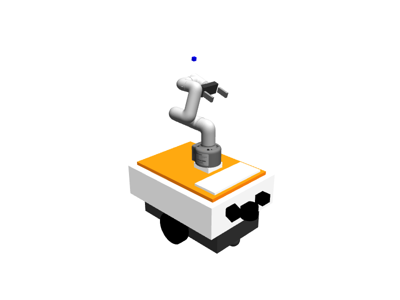

# simulate

本包除 Gazebo 机器人、传感器和世界外，还包含临时换层节点 `fake_elevator`。

## Gazebo 真值定位

真值定位实现已独立放在
`src/slam/gazebo_ground_truth_localization`。本仿真包只负责在 world 中加载
`libgazebo_ros_state.so`，为该定位后端提供 `/gazebo/model_states`。
配置和接口说明见真值定位包 README；真实机器人不得使用此后端。


## fake_elevator

节点由 `simulate.launch.py` 随机器人实体启动，位于 `/<robot>/fake_elevator`。它保持一套可被
真实电梯管理器替换的模块接口：

| Topic | 消息 | 方向 |
|-------|------|------|
| `/<robot>/fake_elevator/info` | `ElevatorInfo` | task_manager → fake_elevator |
| `/<robot>/fake_elevator/status` | `ElevatorStatus` | fake_elevator → task_manager |
| `/<robot>/fake_elevator/command` | `ElevatorCommand` | task_manager → fake_elevator |

`ElevatorInfo.operation` 区分两类任务：

1. `call`：发布 `Calling`，等待 `call_delay_sec`（默认 3 秒）后完成，不移动模型也不切图。
2. `ride`：发布 `Riding` 并等待 `ride_delay_sec`，随后从
   `<map_root>/<target_floor>/<target_floor>_points.json` 读取唯一的
   `elevator_inside` 点，进入 `MovingModel`。
3. `SwitchingMap`：把 heartbeat 的 `current_map` 改为目标楼层、状态改为
   `localization_lost`，再调用 `/<robot>/map_server/load_map` 加载
   `<map_root>/<floor>/<floor>.yaml`。
4. `Relocalizing`：使用上一楼层梯内点调用 `/<robot>/relocalize` 模式 1；成功后等待
   `post_relocalize_settle_sec`（默认 3.0 秒），让新 TF 和全局代价地图完成传播。
5. `Finished` 或 `Failed`：将最终结果和匹配分数写入状态消息。

Pause、Resume、Terminate 对当前电梯子任务生效。状态话题使用 transient-local QoS，使后加入的
task_manager 或监控端也能读取最新阶段。

`fake_elevator` 不控制真实轿厢，也没有呼梯、门控、进出梯检测和安全联锁。它目前只验证
“任务拆分 → 换图 → 重定位 → 继续导航”的编排链路；接入真实电梯时应保持上述消息接口。

换层移动不会直接把地图点位当成 Gazebo world 坐标。节点按照 image2gazebo 的居中模型
规则，读取目标地图的分辨率、栅格尺寸、origin，以及 `drawn_model.world` 中目标楼层
模型的 world 位姿，以地图中心为楼层模型原点完成确定性转换。转换不依赖当前 AMCL、
odom 或上一楼层位姿。随后仅调用与 Web 手动 Gazebo 页面相同的
`POST /api/gazebo/set_model_state`，同步等待后端返回成功后才继续切图。fake_elevator
不再直接调用 Gazebo ROS service、订阅 `/gazebo/model_states` 或执行 `gz model`。

切图时先更新 heartbeat，并等待本节点从 `robot_status` 实际观察到目标楼层；再等待
订阅传播窗口后调用 map_server load_map，避免新 OccupancyGrid 早于楼层状态到达
relocalization 后被重置。

## 机器人几何与传感器约束

默认机器人已替换为 `smolvla-demo` 的完整移动操作模型：OpenDelivery 底盘、
myCobot 280 M5 机械臂、双指夹爪及腕部手眼相机。机械臂采用源项目的
`Simulation.FOLD_Q` 收纳姿态，夹爪每指张开 28 mm；尺寸、网格、纹理和安装位置
保持原比例。当前将臂和夹爪关节固化为 fixed，用于导航时稳定展示及实体碰撞，
尚未接入 SmolVLA 推理、机械臂动作控制或 Gazebo 抓放。



`urdf/smolvla_arm.urdf.xacro` 随主模型加载；所有新增 link 和 joint 使用
`frame_prefix`，腕部图像为 `/<robot>/camera/wrist/image_raw`、
相机参数为 `/<robot>/camera/wrist/camera_info`，frame 为
`<robot>/wrist_camera_optical_frame`。相机使用 SmolVLA 的 `vla` 安装配置，
320×240、垂直视场 75°；保留原有前视和下视相机。

网格与纹理安装在 `model/mycobot280/`，运行时无需相邻的 SmolVLA 仓库、
PyBullet、Torch 或模型权重。来源、许可和校验清单见
[模型来源](model/mycobot280/SOURCES.md)。要从相邻源码重新导入，可运行：

```bash
python3 scripts/import_smolvla_model.py ../smolvla-demo
```

随后在 OpenDelivery 工作区执行 `colcon build --packages-select simulate --symlink-install`，
重新加载 `install/setup.bash`，再重启仿真并重新生成机器人。

`urdf/simple_2d_robot.urdf.xacro` 是机器人模型源文件。底盘离地 35 mm，
前后低摩擦支撑球防止绕驱动轮轴俯仰；轮距仍为 260 mm，轮径仍为 120 mm。
外壳下沿为 125 mm、上沿为 240 mm，避开轮顶并覆盖 170 mm 高的激光扫描面，
使其他机器人仍可看到外壳。前视与下视相机左右分布，外壳位于各自镜头后方。

自体激光过滤使用 Gazebo Classic / ODE：对全部自身碰撞体和每条实际射线设置
碰撞掩码，同时处理射线空间与 ODE 双向 OR 判定。仅设置 multiray 父碰撞体无效。
各机器人必须使用不同的 `collision_bit`（有效值为 4 到 134217728 之间的单一位；
1、2 为引擎保留位）。过滤保留墙体、其他机器人和实体接触碰撞，不能用扩大
`range/min` 替代。模型的激光扫描范围仍为前方 180°，不提供后方障碍覆盖。

导航局部与全局 costmap 使用相同矩形 footprint：X 为 -0.21～0.26 m、Y 为
-0.16～0.16 m，覆盖外壳、传感器与收纳机械臂的全部碰撞体。
修改姿态或尺寸时同步检查导航轮廓与通道可通行性。

验证：在工作区 source ROS 环境后运行
`python3 -m pytest src/simulate/simulate/test/test_robot_geometry.py`，会展开 Xacro、
转换为 SDF，检查双相机全部像素视线与机身外观包围盒、离地间隙、轮顶间隙和
扫描面高度。修改插件后需 `colcon build --packages-select simulate nav_bringup`。
Gazebo 已加载的实体不会热更新；重新启动仿真世界并重新生成机器人后生效，
导航参数在导航节点重启后生效。

原生动态回归（不依赖 ROS/DDS 发现，也不会向现有 ROS 图发布消息）：

```bash
source /opt/ros/foxy/setup.bash
source install/setup.bash
DISPLAY=:99 python3 src/simulate/simulate/test/verify_robot_runtime.py
```

需要已有可用的 X 显示服务（`:99` 是本项目默认 Xvfb 显示号），以及 Gazebo 开发库、
`pkg-config` 和 C++ 编译器。脚本创建独立 Gazebo master 和临时世界，运行 27 秒仿真，
验证朝后穿过自身的激光、其他机器人可见性、前进／倒退／转向、实体接触和相机输出。
结束后自动关闭测试进程，报告与四张 PNG（含腕部图像）保存在输出的临时目录。该测试直接驱动轮子，
不替代完整导航任务或 ROS 相机话题链路测试。
